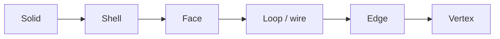
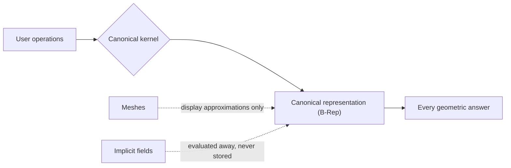
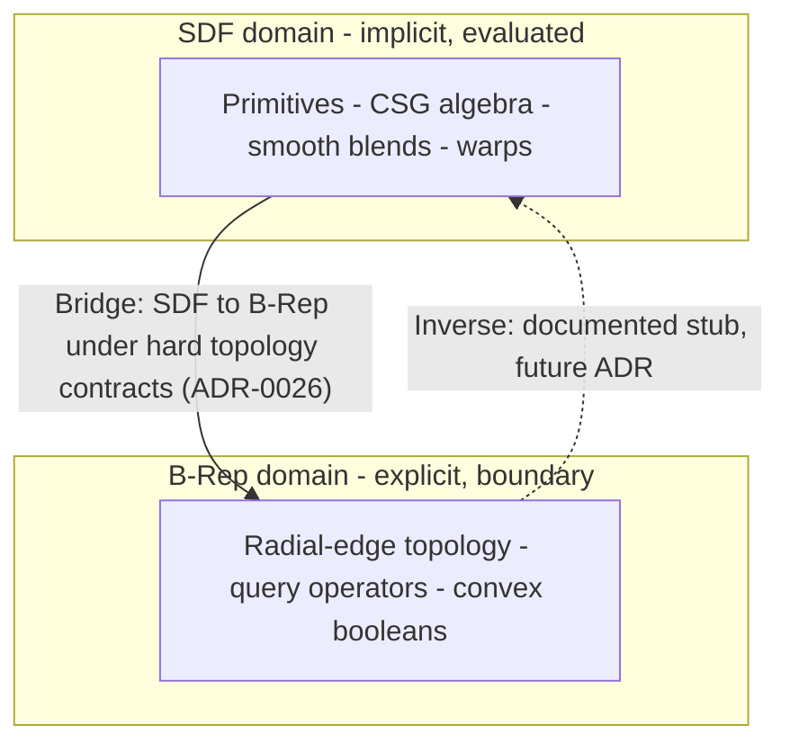
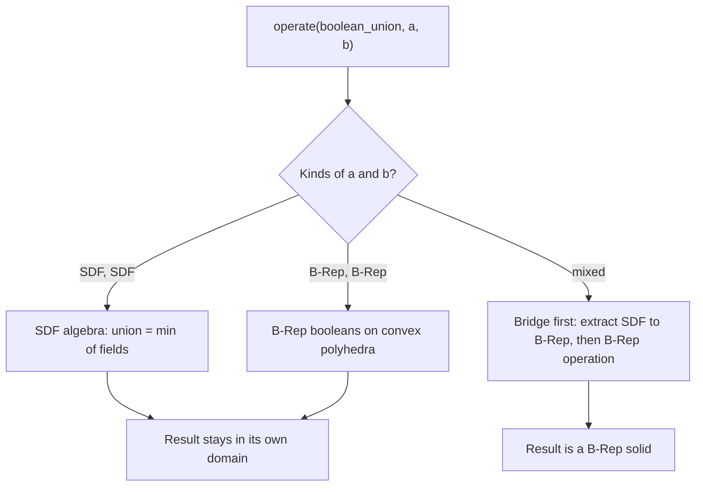

:::tip[Learning objectives]
After studying this chapter, you should be able to:

- characterise the two great families of solid representation — *implicit/evaluated* and *explicit/boundary* — and name one canonical member of each;
- explain why a signed distance field makes booleans and blends nearly trivial but exposes no topology, and why a boundary representation is precisely the converse;
- describe the canonical-representation pattern of traditional kernels and the costs it imposes on "guest" representations;
- state what **first-class peer** means operationally in CAD_0: native operations in each domain, dispatch on operand kinds, and a bridge governed by hard topology contracts;
- read the dispatch matrix of §2.6 as an engineering consequence of the dual-representation hypothesis, including its honest open cells.
:::

**Abstract.** Chapter 1 identified representation as the founding duty of a geometry kernel. This chapter examines that duty in depth. It introduces the two great families of solid representation — implicit fields, exemplified by the signed distance field, and boundary structures, exemplified by the B-Rep — and studies what each makes cheap, what each makes expensive, and what each cannot express at all. It then analyses the canonical-representation pattern that has dominated kernel design for four decades, and formulates the alternative hypothesis on which CAD_0 is built: SDF and B-Rep as first-class peers, neither derived from the other, with operations native in both domains and a contract-bound bridge between them. The chapter closes with the dispatch matrix — the concrete, testable shape that the hypothesis takes inside the kernel — and an honest accounting of the price the hypothesis demands.

## 2.1 Two ways of knowing a solid

Ask what it means for a computer to "know" a solid, and three distinct questions emerge. Is a given point **inside** the material or outside it? Where exactly is the **surface** that separates them? And what is the solid's internal **structure** — which faces bound it, which edges join those faces, which vertices close those edges? Every representation of a solid is, in essence, a choice about which of these three questions is answered immediately, which is answered by computation, and which is not answered at all. There is no representation that makes all three questions simultaneously trivial, and this impossibility — benign, but unavoidable — is the origin of everything that follows in this chapter.

The history of solid modelling has explored this trade-off space thoroughly, and two families have proven durable. The **implicit family** represents a solid by a function evaluated at points: the inside question is answered by evaluating the function, the surface is where the function crosses zero, and structure — faces, edges, vertices — does not exist until it is extracted. The **explicit family** represents a solid by its boundary, described as a structure of faces, edges and vertices: the structure question is answered by reading the data structure, the surface is the data structure, and the inside question requires classification algorithms running against that structure. Each family is a complete answer to the question "what is a shape?" — and each is complete on its own terms, in its own currency. The next two sections meet them in turn, one at a time, before we ask how — or whether — they can share a kernel.

## 2.2 The implicit family: signed distance fields

The canonical member of the implicit family is the **signed distance field**, or SDF. Formally, an SDF is a function *f* from points of space to real numbers, *f*: ℝ³ → ℝ, with two properties: the **zero set** of *f* — the points where *f*(*p*) = 0 — is the surface of the solid, and the **sign** of *f* tells the side. By the usual convention, which CAD_0 follows, negative values lie inside the material and positive values outside. The defining ambition of the field is that *f*(*p*) equals the *distance* from *p* to the nearest surface point — |*f*(*p*)| is how far you are from the boundary, whichever side you are on. When this is exactly true, the field satisfies the Eikonal property |∇*f*| = 1 almost everywhere, with a most useful consequence: the **gradient** ∇*f*, computable by finite differences or analytic rules, is the surface normal wherever the surface is smooth. A field that knows its own normals is a field from which images, meshes and measurements can be derived at will.

The remarkable power of the SDF is that its **boolean operations are algebra**. If *f*ₐ and *f*ᵦ are the fields of two solids, the field of their union, intersection and subtraction is given, pointwise, by min and max (Listing 2-1). No intersection curves must be computed, no topology must be re-torn and re-stitched; the composite solid *is* the composite function, exactly, everywhere, at every scale the evaluation grid can reach. This **closure property** — solids under booleans remain solids of the same kind — is the family's founding advantage, and it is why CSG (constructive solid geometry) trees of primitives evaluate so naturally in the implicit world.

```text
Listing 2-1. Boolean operations as pointwise algebra. fa and fb are the
fields of solids a and b; the result is the field of the composite solid.

union(a, b)(p)        = min( fa(p), fb(p) )
intersection(a, b)(p) = max( fa(p), fb(p) )
subtract(a, b)(p)     = max( fa(p), −fb(p) )      # a minus b
```

The same algebra extends to operations that are famously difficult in the explicit family. A **smooth blend** — a fillet-like rounding of the union of two solids — is a modification of the minimum, not a new algorithm: the polynomial smooth minimum of Listing 2-2 replaces the hard crease of `min` with a rounded transition of controllable radius *k*, in one uniform expression, for any pair of solids whatsoever. Likewise, **domain warps** — twisting, bending, tapering — are changes of the evaluation coordinate rather than changes of the shape data: to twist a solid about an axis, evaluate its field at the un-twisted point that maps to each query point. Chapter 6 treats blends and warps properly, including the Lipschitz analysis that CAD_0 applies to its twist warp (ADR-0029); for now, the point is the family's character: operations on implicit solids are *compositions of functions*, and composition is cheap, uniform and composable in turn.

```text
Listing 2-2. The polynomial smooth minimum. The crease of min is replaced
by a rounded transition of controlled width k, for any pair of fields.

smooth_union(a, b, k)(p):
    x = fa(p), y = fb(p)
    h = clamp( 0.5 + 0.5 * (y − x) / k , 0.0, 1.0 )
    return mix(y, x, h) − k · h · (1 − h)
```

The price of this elegance is structural silence. An SDF has **no faces, no edges, no vertices** — not hidden ones, none. The question "which faces meet at this edge?" is not merely unanswerable from the field; it is *unformulated*, because the field never carved its surface into entities. Making images or meshes requires **extraction**: sampling the field on a grid and reconstructing an approximate surface where it crosses zero — the task CAD_0 assigns to Marching Cubes 33 with vertex welding (ADR-0015, ADR-0016), the subject of Chapters 8 and 9. Extraction is honest work, but it is approximation with a grid resolution attached, and its output is a mesh, not a structured boundary. Finally, the family has a subtle numerical temper: the field is exact only where its defining expression is evaluated exactly, and every composition — every blend, every warp — must be examined for how far it may distort the distance property on which normals, offsets and bounding estimates depend. The implicit world is a world of analysis, and analysis must be done.

## 2.3 The explicit family: boundary representation

The explicit family answers the representation question by recording the boundary. A **boundary representation** (B-Rep) describes a solid as the volume enclosed by a shell of **faces** — bounded patches of analytic or parametric surfaces — where faces meet along **edges** — bounded curves — and edges terminate at **vertices**. Around each face, a closed boundary loop (or wire) determines what part of the surface is meant; orientation conventions — which side of a face the material is on, which direction an edge runs — are recorded *in the data*, not inferred. The deepest methodological idea of the B-Rep is the strict split between **topology** (the incidence structure: what bounds what, what connects to what) and **geometry** (the actual surfaces and curves that flesh the structure out). Topology is combinatorics; geometry is analysis; keeping them separate is what makes B-Reps auditable.



*Figure 2-1. The containment hierarchy of a boundary structure. Topology — the containment itself — is stored explicitly; geometry — the surfaces and curves of faces and edges — is attached to the topological entities.*

Because the boundary is explicit, the explicit family owns exactly what the implicit family lacks. Faces, edges and vertices are **first-class, nameable entities**, which makes topological queries direct: which faces share an edge, how many edges meet at a vertex, is the shell closed and consistently oriented. Exact analytic surfaces survive as exact analytic surfaces — a cylinder is a cylinder, not a faceted memory of one — which matters for manufacturing data, for drawing, and for exchange formats such as STEP that are defined in boundary terms. And validity is checkable *structurally*: counts, closures and orientations can be audited without evaluating a single function. The costs mirror the advantages. **Boolean operations** — the bread and butter of modelling — require intersecting the input surfaces, classifying the resulting fragments against the input solids, and re-stitching a new boundary from the pieces; each stage is a robustness problem, since every intersection is computed in floating point and every classification has borderline cases. **Blending**, natural in the implicit world, becomes surface surgery in the explicit one. And the data structures that hold all this — half-edge for manifold solids, the **radial edge** for the general non-manifold case (Weiler's structure, which CAD_0 adopts; ADR-0012 and ADR-0021) — are intricate enough to deserve their own chapters (10 and 11). The explicit family trades computation for bookkeeping, and the bookkeeping is real.

## 2.4 The canonical pattern, and its costs

Given two complete but opposite answers to "what is a shape?", the traditional kernel takes the obvious managerial route: **choose one canonical representation, and make everything else a guest**. The mainstream choice has been the B-Rep, and the pattern is recognisable across the industry: meshes are approximations generated for display and discarded; CSG trees are evaluation-time descriptions resolved into boundaries; implicit fields, where present at all, are special-purpose guests. The pattern's appeal is real and should be stated fairly. One canonical form means one set of validity invariants to maintain, one boolean engine to debug, one query layer to trust. Conversions flow in a fixed direction — towards the canonical — so the kernel's internal contracts have a single shape. For a commercial kernel with decades of accumulation, this discipline is not conservatism; it is survival.



*Figure 2-2. The canonical pattern: all operations and answers flow through one representation; the other families exist, if at all, as one-way inputs or throw-away outputs.*

The costs appear the moment a user's natural operation does not fit the canonical mould. Whatever is easy in a guest representation must be either **translated into canonical terms** — often expensively, sometimes lossily — or **reimplemented as a bolt-on**, outside the kernel's invariants. A mesh boolean in a B-Rep kernel is an add-on with its own tolerances and its own failure modes, not a citizen. A rolling-ball blend between two curved patches — in the implicit world one line of smooth minimum — becomes genuine surface-intersection surgery in the canonical B-Rep, with the robustness hazards that implies. And the traffic is one-way by construction: the canonical kernel's contracts never developed the habit of *returning* to the guests, so approximations leak into models (a "cylinder" that is really a 512-facet mesh) and never leak back. None of this is a logical flaw; the pattern is internally consistent. It is a strategic choice about which family's strengths the whole system will inherit, and it quietly demotes the other family to second-class data.

## 2.5 The dual hypothesis: peers, not master and servant

CAD_0's founding question is whether the choice must be made at all. The hypothesis it tests (ADR-0002) can be stated in one sentence: **signed distance fields and boundary representation coexist as first-class peers — neither derived from the other, every operation native in both domains, and the system dispatching on operand kinds.** The load-bearing word is *peers*. It does not mean the two representations are stored in one blended data structure, and it does not mean they are equally convenient for every task. It means three concrete things, each testable in the repository. First, **native operations in both domains**: booleans exist in the SDF domain as field algebra and in the B-Rep domain as boundary algorithms; neither domain's operations are implemented by secretly converting to the other and back. Second, **no forced canonical form**: an SDF body created in the scene remains an SDF body — it is not silently evaluated into a mesh or a boundary the moment the user looks away. Third, **a disciplined border**: where the domains must meet, they meet through an explicit, contract-governed bridge (SDF → B-Rep extraction, ADR-0026), not through ad hoc conversions scattered through the code.



*Figure 2-3. The peer pattern of CAD_0: two complete domains, each with native operations; the bridge between them is explicit, directed (SDF to B-Rep is implemented; the inverse is a documented stub), and governed by contracts rather than convenience.*

The hypothesis, like all honest hypotheses, makes claims that can fail, and the project tracks them in public. The capability table on the project's landing page is exactly this bookkeeping: native SDF capabilities marked available, B-Rep booleans marked partial (convex polyhedra today), the inverse bridge marked as an approximate stub. This is what "first-class" means in a research-grade system — not that every cell of the table is green, but that *every cell is stated*, with its status and its ADR. A kernel that hid the yellow cells would be less dual, not more.

:::note[In CAD_0 — where the hypothesis lives in the tree]
The dual hypothesis is visible in the repository's layout long before it is visible in any single file. `core/geometry/` defines `Shape` as a `std::variant` over the native representations (ADR-0002), so no arm of the variant outranks the other at the type level. `core/sdf/` is a complete implicit kernel in its own right — primitives, boolean and smooth-blend operators, transforms, batched evaluation. `core/brep/` is the explicit counterpart — radial-edge topology, query operators, analytic seam wires, convex booleans. `core/bridge/` exists *because* two first-class domains need a disciplined border, not a pile of conversions. And `core/scene/` stores `SceneNode`s that may be SDF bodies or meshes, with the builder registry treating both kinds as creatable, first-class citizens. Four directories, one hypothesis: the tree *is* the architecture.
:::

## 2.6 First-class, in data: the dispatch matrix

A hypothesis earns its keep when it survives contact with data structures, so let us make it concrete. At the centre of CAD_0's `core/geometry/` sits a deliberate smallness: a **shape** is a variant (ADR-0002) — either an SDF node or a B-Rep entity — and a scene node is likewise a variant of an SDF body or a mesh. Nothing in the type system privileges either arm.

```text
Listing 2-3. The dual hypothesis as data, then as control flow.

type Shape     = variant[ SdfNode , BrepSolid ]     # ADR-0002
type SceneNode = variant[ SdfBody , Mesh ]          # scene level

function operate(op, a, b):                        # dispatch on kinds
    match ( kind(a), kind(b) ):
        (SDF , SDF ) : return sdf_op (op, a, b)    # result: SDF node
        (BREP, BREP) : return brep_op(op, a, b)    # result: B-Rep solid
        (SDF , BREP) |
        (BREP, SDF ) : a' = bridge_to_brep(a)      # contract-bound extraction
                       return brep_op(op, a', b)   # result: B-Rep solid
```



*Figure 2-4. Dispatch on operand kinds. Native operations keep results in their own domain; mixed-domain operations cross the bridge once, in the implemented direction.*

Reading Listing 2-3 and Figure 2-4 together yields the kernel's **dispatch matrix**, which is worth stating as a table because it is, in effect, the hypothesis written in operational form:

| Operation | SDF × SDF | B-Rep × B-Rep | Mixed operands |
| --- | --- | --- | --- |
| Union / subtract / intersect | field algebra (`min`/`max`) — native, exact | convex-polyhedra booleans — native, contract-checked | bridge SDF → B-Rep, then B-Rep operation |
| Smooth blend | smooth minimum — native, one expression | not yet offered (surface surgery; open cell) | extract, then not available — open cell |
| Point classification / distance | field evaluation — native | classification against boundary — native | by kind of the queried shape |
| Topological queries (faces, edges, valence) | unformulated without extraction | topology operators — native | — |
| Rendering / export | via extraction (mesh) — approximation | tessellation / direct export | follows result domain |

Two readings of this matrix are important. The optimistic reading: the diagonal cells — each domain solving its own problems natively — are exactly what the canonical pattern cannot offer, and they are all green. The honest reading: the mixed column and the blend row show where the hypothesis is still being paid for, and the matrix does not pretend otherwise. Both readings are the point. The dispatch matrix is not a marketing table; it is a *research instrument*, and Chapters 5 through 13 are, in a sense, the cell-by-cell story of how it got its current shape and where each remaining yellow cell will come from.

## 2.7 The price: duplication, consistency, and the bridge

Intellectual honesty about the dual hypothesis begins with its bill. **Duplication** is the first and least negotiable item: two native representations mean two implementations of every shared concept — two boolean stories, two validity regimes, two sets of tests — and CAD_0 pays it knowingly; the B-Rep booleans of Part III are not the SDF booleans of Part II re-skinned, and the project would not have it otherwise. **Consistency** is the subtler item: with two worlds, something must guarantee that the two worlds still describe *the same geometry* when they meet. That something is the bridge, and its discipline is what distinguishes the peer pattern from mere cohabitation. CAD_0's SDF → B-Rep extraction (ADR-0026) runs under **hard topology contracts**: vertex, edge and face counts are pinned per extraction grid, closed-and-orientable status is enforced as a structural invariant, Euler characteristic and genus are *reported* only where they are soundly derived, and genus-1 extractions — the pierced box, χ = 0 — re-run bit-identically. The bridge, in other words, is not a converter that happens to exist; it is the place where the dual hypothesis is *tested*, every run, against contracts that were written before the code that satisfies them.

The inverse direction — B-Rep → SDF — shows the price from its other side, and CAD_0's treatment of it is a model of research honesty. Turning an arbitrary boundary into a *true* signed distance field is, in general, an approximation enterprise: CAD_0 offers today a documented stub (primitive detection plus mesh-based field), explicitly marked, with the full treatment deferred to a future ADR rather than smuggled in behind a confident name. A dual-representation kernel that pretended both directions were equally solved would be asserting a falsehood; one that marks the asymmetry — implemented direction contract-bound, inverse direction stubbed and dated — is doing exactly what the hypothesis demands: keeping both domains first-class *as domains*, while letting each capability earn its place by contract.

:::note[In CAD_0 — the bridge's receipts]
The contracts of ADR-0026 are worth reading as a specimen of what "hard" means in practice. Extraction pins the expected vertex, edge and face counts **per grid resolution** — a wrong count is a failed extraction, not a warning. The structural invariant enforced is `is_closed_orientable`; Euler characteristic and genus are *reported*, derived only for single closed-orientable shells, and `is_closed_manifold` remains as the exact χ = 2 compatibility wrapper — an exercise in saying precisely what you know and no more. Genus-1 extractions (the pierced box, χ = 0) are part of the certified set and re-run bit-identically. The twist warp of ADR-0029 closes the loop from the other side: its property suite includes twisted bridge extractions, so a warped field's boundary credentials are checked under the very same contracts. And the same numbers reach the user: the desktop app's Debug menu reports χ, genus and closed-orientable for any selected body — the contracts, surfaced in the product.
:::

## 2.8 The reward: strength where it matters

What does the wager buy? Three vignettes, chosen because each would be awkward somewhere in a canonical kernel. **The blended joint.** A smooth union of a sphere and an offset sphere with blend *k* = 0.6 is one expression in the SDF domain — Listing 2-2 with two field arguments — and it evaluates everywhere, blends included, with the gradient falling out for free. In a canonical B-Rep world the same shape is a rolling-ball blend across parametric patches, an operation whose general robustness has consumed careers. **The audited solid.** "Is this shell closed and consistently oriented? How many faces? What is the genus?" — in the B-Rep domain these are reads of the structure, and CAD_0 surfaces them (Euler characteristic, genus, closed-orientable) in the desktop app's Debug menu for any selected body. The SDF domain cannot answer them *at all* without extraction — which is precisely why having a native B-Rep side matters, rather than treating boundaries as a rendering afterthought. **The bridge with receipts.** A twisted solid (the twist warp of ADR-0029, itself held to a Lipschitz contract) can be extracted into a B-Rep whose counts are pinned in advance and whose genus-1 variants re-run bit-identically — geometry produced in one family and certified in the other, with the certification traceable to an ADR. Each vignette uses one domain for what that domain is *best at*; none requires the other to be demoted for the trick to work. That, and nothing vaguer, is what "first-class peers" was coined to mean.

A practitioner's distillation of the same point, to be revisited with tools in hand after Parts II and III:

| You need... | Reach for | Why |
| --- | --- | --- |
| Rounded, organic composition; fast iteration on form | SDF | booleans and blends are function algebra; no topology to re-stitch while exploring |
| Exact faces, topology queries, drawing, exchange-facing structure | B-Rep | boundary entities are nameable and exact; queries are structural reads |
| A model whose geometry must be *certified* (counts, closure, genus) | the bridge | hard contracts pin the extraction, bit-identically |
| A mesh for display or STL export | either, via extraction | extraction is approximation by design; keep the native body as truth |

## 2.9 How the handbook proceeds

The rest of the book follows the two domains in the order the kernel was built, because that order is also the pedagogically sound one. Part II (Chapters 5–9) works the implicit world from primitives and CSG algebra through blends and warps to batched evaluation and mesh extraction; Part III (Chapters 10–13) works the explicit world from radial-edge topology through query operators and convex booleans to the bridge itself, where the two halves of the book finally meet under contract. Part IV then builds the product layers — scene, format, bindings, application — on top of both. Chapter 3 first, though: before either family can be trusted, the handbook owes you an account of the arithmetic both families stand on.

## Summary

- Any representation chooses which questions are cheap: **inside**, **surface**, **structure**. The implicit family answers inside by evaluation and hides structure; the explicit family *is* structure and pays for inside-classification with algorithms.
- A **signed distance field** stores a solid as a function whose zero set is the surface and whose gradient is the normal; booleans are min/max algebra, blends are smooth minima, warps are coordinate changes — but it has no faces or edges, and images require extraction.
- A **B-Rep** stores the boundary as topology (vertices, edges, faces, loops — CAD_0 uses the radial edge) dressed with exact geometry; it makes structure nameable, queries structural and validity auditable — at the price of algorithmically hard booleans and blends.
- The canonical pattern — one representation, everything else a guest — buys invariant-simplicity at the cost of demoting every other family; CAD_0's hypothesis (ADR-0002) refuses the demotion: **SDF and B-Rep as first-class peers**, native operations in both, dispatch on operand kinds, and a bridge (ADR-0026) that is directed, contract-bound and honestly asymmetric.
- The dispatch matrix is the hypothesis in testable form: green diagonal, stated yellow cells, no hidden conversions; its price is duplication and a consistency burden, paid in contracts (pinned V/E/F, genus checks, bit-identical re-runs) rather than in promises.

## Further reading

- **Ricci, R. (1973). "A Constructive Geometry for Computer Graphics." *The Computer Journal* 16(2).** The earliest systematic statement of implicit solids and their CSG algebra — Listing 2-1's pointwise min/max has its ancestry here, and blends begin with Ricci's "superellipse" combination.
- **Requicha, A. A. G., and Voelcker, H. B. (1983). "Solid Modeling: A Historical Summary and Contemporary Assessment." *IEEE Computer Graphics and Applications* 2(2).** The field's own mid-course report; the clearest short account of how the canonical-B-Rep pattern consolidated, and of what CSG-to-B-Rep conversion cost at the time.
- **Weiler, K. J. (1986). "The Radial Edge Structure: A Topological Representation for Non-Manifold Geometric Boundary Modelling." In *Geometric Modelling* (SINTEF/North-Holland).** The data-structure paper behind CAD_0's topology choice (ADR-0012); read it before Part III to see why half-edge is not enough.
- **Mäntylä, M. (1988). *An Introduction to Solid Modeling*. Computer Science Press.** Still the most careful book-length treatment of B-Rep machinery — Euler operators, booleans, validity — and the natural companion to Chapters 10–12.
- **Frisken, S. F., Perry, R. N., Rockwood, A. P., and Jones, T. R. (2000). "Adaptively Sampled Distance Fields: A General Representation of Shape for Computer Graphics." *SIGGRAPH 2000*.** The paper that made distance fields a first-class graphics representation; its analysis of field sampling and precision anticipates the extraction topics of Chapters 8–9.
