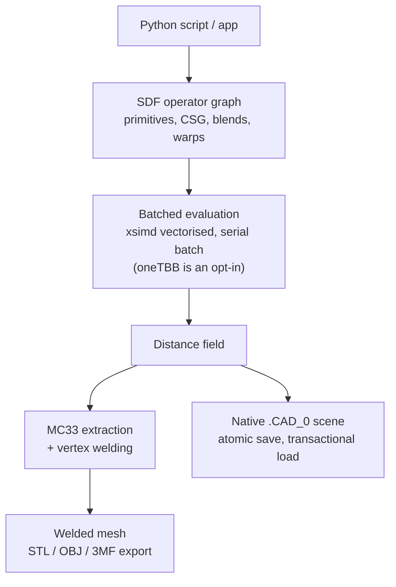

:::caution[API Stability]
The Python API is currently **unstable**. Breaking changes may occur without major version bumps as the kernel evolves.
:::

The path of a typical Python session through the kernel:



## 1. Smoke Test

After building with `-DCAD_0_BUILD_PYTHON=ON` (see [Build from Source](./build-from-source/)), run this quick validation:

```bash
cd build/python
python3 -c "
import sys; sys.path.insert(0, '.')
import CAD_0

# 1. Create an SDF primitive — a native representation, not a mesh
sph = CAD_0.sdf.sphere(radius=2.0)
print(sph.describe())

# 2. Extract a mesh
mesh = CAD_0.sdf.marching_cubes(sph, resolution=16)
print(f'Vertices: {mesh.vertex_count()}, Triangles: {mesh.triangle_count()}')
"
```

**Expected output:**

```text
Sphere(radius=2.0)
Vertices: 480, Triangles: 960
```

## 2. Common Operations

- **CSG operations**: native SDF booleans (`union`, `subtract`, `intersect`) and smooth blends (`smooth_union` and friends) — all native to the SDF domain.
- **Transforms**: `translate`, `rotate`, and the twist warp (ADR-0029). Offsets are `CAD_0.math.Vec3f` values, not tuples — the bindings do not auto-convert.
- **Evaluation**: batched, vectorised evaluation via `CAD_0.sdf.evaluate`. The batch runs **serially**; oneTBB is an off-by-default opt-in (ADR-0009).
- **Mesh extraction and export**: `marching_cubes` returns a welded mesh; `CAD_0.io.export` writes STL, OBJ or 3MF, detecting the format from the extension.
- **Native project files**: `CAD_0.io.save` / `CAD_0.io.load` persist a whole scene (camera included) in the `.CAD_0` format, with atomic save and transactional load.
- **B-Rep queries**: the exact kernel is queryable from Python — `CAD_0.brep.body_query` (counts, χ, genus, provenance), `CAD_0.brep.mass_properties`, `CAD_0.brep.ssi_query` (the analytic surface–surface intersection table, with `translate_body` for positioning) and `CAD_0.brep.bool_union`.

## 3. The Command Line (Optional `[cli]` Extra)

The `CAD_0` command evaluates SDF scripts, exports meshes and prints body metadata — headless, no Qt involved. It rides on `typer`/`rich`, which are **not** base dependencies: install the `[cli]` extra and it runs; install the base package only and the command answers with the hint naming the extra instead of a traceback. The package is not on PyPI — install from a clone:

```bash
pip install ".[cli]"

CAD_0 info examples/sdf_sphere.py                    # metadata table
CAD_0 primitives                                     # the primitive/operator list
CAD_0 eval-sdf examples/sdf_sphere.py --output sphere.stl
CAD_0 view examples/sdf_lattice_ball.py              # opens a viewer window
CAD_0 slice examples/sdf_lattice_ball.py --plane z --at 0.0
```

`eval-sdf` writes STL/OBJ/3MF (format detected from the extension); `view`/`slice` open matplotlib windows and need a display.

:::tip[Performance]
For heavy scripting, ensure you are running the Release build. Debug builds evaluate SDFs significantly slower due to the lack of optimisations.
:::
