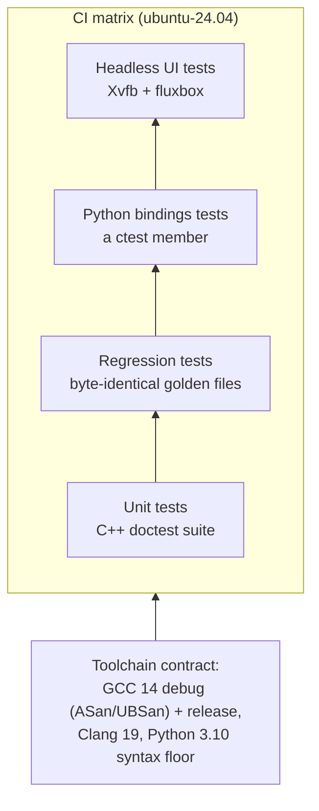

Determinism and correctness are non-negotiable in CAD_0. The testing infrastructure is designed to catch regressions before they merge.

## The Testing Pyramid



1. **Unit tests**: C++ `doctest` suite covering core math, SDF, and B-Rep operations.
2. **Regression tests**: byte-identical golden files ensure evaluation values never silently change.
3. **Python bindings tests**: validate the `nanobind` exposure and Python-side logic; the bindings suite runs as a ctest member — under the preloaded sanitizers in the debug job.
4. **Headless UI tests**: the PySide6 UI suite runs offscreen under Xvfb — including the GL viewport, picking and navigation.

## Running Tests Locally

After building with `-DCAD_0_BUILD_TESTING=ON`:

```bash
# Run the whole suite: C++ unit tests, bindings, goldens
ctest --test-dir build
```

## CI Matrix

Every push to `main` runs the full matrix on `ubuntu-24.04`:

- **GCC 14 debug** with ASan/UBSan — the C++ suite *and* the Python bindings under the preloaded sanitizer;
- **GCC 14 release**;
- **Clang 19**;
- a dedicated job byte-compiles the tree under **Python 3.10** (the syntax floor), plus a subject lint.

`fail-fast` is off: one red job never hides the others.

:::tip[Toolchain Contract]
Fixes must not silently change evaluation values. All changes are checked against golden files. If a legitimate algorithmic improvement changes output, the golden files must be explicitly updated with justification. Warning audits and any `-Werror` change must be verified against the CI compilers (GCC 14, Clang 19) before push — the presets pin them (`g++-14` / `clang++-19`), so a preset build is the verification.
:::
